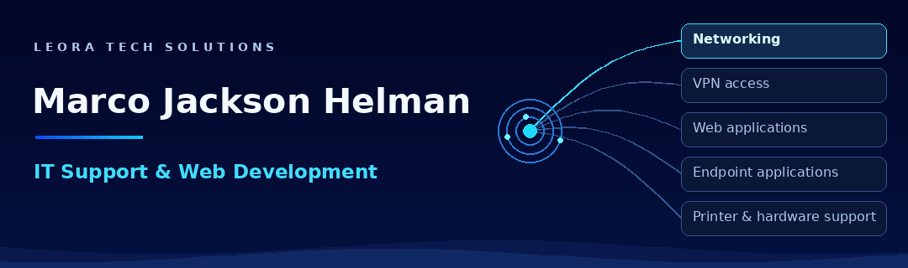

At **YAS Tanzania**, I help colleagues restore VPN access, troubleshoot Windows devices, and resolve printer and hardware issues. I previously worked as a software developer at **EnterSoft Systems Ltd** and continue building web applications with PHP and Python.

> [!IMPORTANT]
> 
>
> When a colleague loses connectivity, I want to understand where the connection breaks. As I study for the **CCNA**, I use **Cisco Packet Tracer** to practice VLANs and routing, follow a packet from one network to another, and test what happens when a configuration changes.
